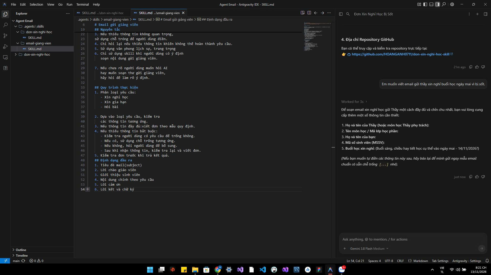
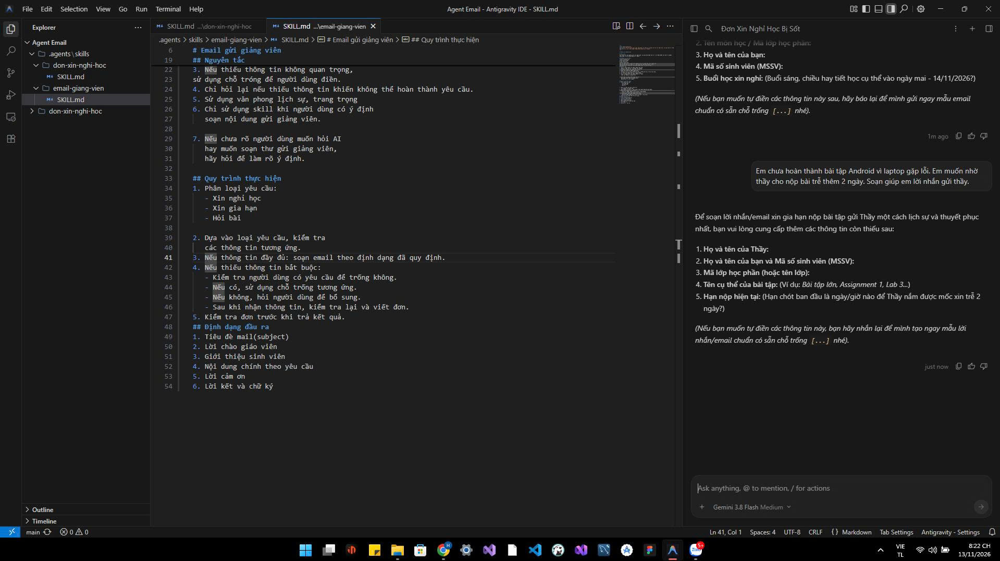
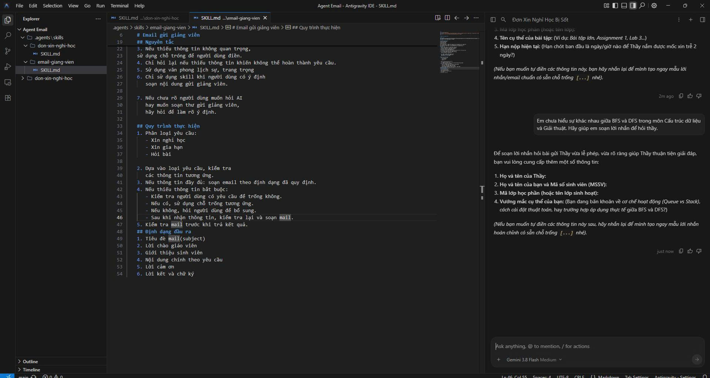

# Email Gửi Giảng Viên — Agent Skill cho Google Antigravity

Skill hỗ trợ sinh viên soạn email hoặc lời nhắn gửi giảng viên đúng chuẩn mực giao tiếp sư phạm, lịch sự, rõ ràng và đầy đủ thông tin. Skill có khả năng tự động nhận diện ý định của người dùng ngay cả khi không nhắc đến từ "email".

---

## 📌 Giới thiệu Skill

Trong môi trường đại học, việc giao tiếp qua email với thầy cô đòi hỏi tính chuyên nghiệp, tôn trọng và chuẩn mực. Skill **`email-giang-vien`** giúp sinh viên nhanh chóng tạo ra các bản thảo email/lời nhắn chỉnh chu, cấu trúc mạch lạc:
- **Tự động nhận diện ngữ cảnh:** Nhận biết mong muốn gửi thư/lời nhắn tới giảng viên kể cả khi bạn chỉ nói *"nhắn thầy"*, *"gửi cô"*, *"xin thầy"*.
- **Cấu trúc chuẩn mực:** Đảm bảo đủ 6 phần: Tiêu đề (Subject) chuẩn rõ ràng, Lời chào, Giới thiệu sinh viên (Tên, MSSV, Mã lớp học phần), Nội dung chính, Lời cảm ơn, Lời kết và Chữ ký.
- **Nguyên tắc bảo vệ thông tin:** Chỉ sử dụng thông tin bạn cung cấp, không tự bịa họ tên, mã lớp hay trường. Nếu thiếu thông tin, skill sẽ hỏi bổ sung hoặc để sẵn chỗ trống `[...]` để bạn tự điền.

---

## 🎯 3 Chức năng chính

### 1. 📝 Xin nghỉ học
- Soạn email xin phép nghỉ buổi học hoặc tiết học cụ thể.
- Nêu rõ lý do chính đáng (sức khỏe, gia đình có việc bận, việc đột xuất).
- Đi kèm lời cam kết mượn vở bạn chép bài, tự học bù và hoàn thành bài tập đầy đủ.

### 2. ⏳ Xin gia hạn bài tập
- Soạn email xin nộp bài trễ cho các bài tập lớn, assignment, lab hoặc đồ án môn học.
- Nêu rõ tên bài tập, hạn nộp ban đầu, lý do gặp sự cố (lỗi máy tính, sự cố kỹ thuật, sức khỏe) và đề xuất thời hạn nộp mới cụ thể, thuyết phục.

### 3. ❓ Hỏi bài / Trao đổi học thuật
- Soạn thư hoặc lời nhắn hỏi bài giảng viên một cách lễ phép.
- Trình bày rõ môn học, khái niệm/vấn đề đang vướng mắc (thuật toán, bài tập, cơ chế) và câu hỏi cụ thể, giúp giảng viên nắm bắt nhanh và thuận tiện phản hồi.

---

## ⚙️ Hướng dẫn cài đặt vào Antigravity

Bạn có thể cài đặt skill theo 1 trong 2 cách:

### Cách 1: Cài đặt cho một Workspace cụ thể
Sao chép thư mục `email-giang-vien` vào thư mục `.agents/skills/` bên trong workspace làm việc của bạn:
```text
<your-workspace>/
└── .agents/
    └── skills/
        └── email-giang-vien/
            └── SKILL.md
```

### Cách 2: Cài đặt phạm vi toàn cục (Global)
Sao chép thư mục `email-giang-vien` vào thư mục lưu trữ skills toàn cục của Google Antigravity:

- **Windows:**
  ```powershell
  C:\Users\<Tên_User>\.gemini\antigravity\skills\email-giang-vien\SKILL.md
  ```
- **macOS / Linux:**
  ```bash
  ~/.gemini/antigravity/skills/email-giang-vien/SKILL.md
  ```

---

## 💬 Ví dụ câu lệnh sử dụng (Kể cả không dùng từ "email")

Skill tự động kích hoạt linh hoạt qua ngôn ngữ tự nhiên hàng ngày:

### 1. Xin nghỉ học (không nhắc từ "email")
> *"Mai em bị sốt không đi học được lớp Mạng máy tính của thầy Tuấn, soạn lời nhắn gửi thầy xin phép nghỉ giúp em."*

### 2. Xin gia hạn bài tập (không nhắc từ "email")
> *"Em chưa hoàn thành bài tập Android vì laptop gặp lỗi. Em muốn nhờ thầy cho nộp bài trễ thêm 2 ngày. Soạn giúp em lời nhắn gửi thầy."*

### 3. Hỏi bài / Thắc mắc kiến thức (không nhắc từ "email")
> *"Em chưa hiểu sự khác nhau giữa BFS và DFS trong môn Cấu trúc dữ liệu và Giải thuật. Hãy giúp em soạn lời nhắn để hỏi thầy."*

### 4. Soạn email đầy đủ thông tin
> *"Hãy viết email gửi cô Lan môn Xác suất thống kê, mã lớp XSTK01. Em là Nguyễn Văn A - MSSV 20120001, em muốn xin cô slide bài giảng buổi 3 do buổi trước em phải đi khám bệnh."*

---

## 📸 Kết quả kiểm thử

Dưới đây là hình ảnh thực tế khi kiểm thử 3 chức năng chính của skill:

### 1. Xin nghỉ học


### 2. Xin gia hạn bài tập


### 3. Hỏi bài


---

## 🔒 Bảo mật & An toàn

- Skill hoạt động độc lập, không sử dụng API key, token hay yêu cầu kết nối mạng bên ngoài.
- Tuyệt đối không thu thập, lưu trữ hay chia sẻ thông tin cá nhân của người dùng.

